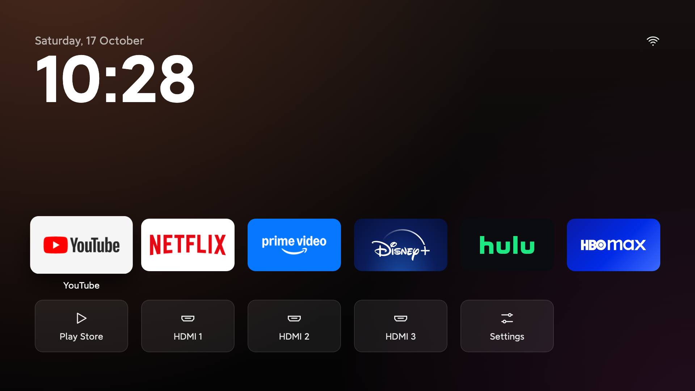

# TV Detox Design Language

The design system behind the TV Detox home screen (`com.ansub.tvhome`). It's written down so another app can share the same look and the same tiny footprint: the whole APK is about **36 KB**.



---

## 1. Principles

1. **Calm over busy.** Show only what the viewer came for: the time, their apps and their inputs. No rows of suggestions, no ads, no badges, no motion on screen when nothing is focused.
2. **Dark, warm and quiet.** The background is a near-black warm gradient. All content is white at different opacities. The only colour on screen comes from the apps' own banners.
3. **Focus is the only highlight.** Nothing glows, pulses or shifts until it's focused. A focused item gets bigger, lifts slightly and gets brighter. That's the whole interaction language.
4. **Made for a remote, read from the sofa.** Everything works with the D-pad, OK, Back and Menu. Type is large and spacing is generous, so it reads from 3 m away.
5. **Weightless.** No image resources, no XML layouts, no libraries, no fonts bundled in. Every visual is code: gradients, rounded rectangles and vector line icons. See [§10](#10-how-it-stays-36-kb).
6. **Plain words.** Labels are short, everyday words ("Add app", "Remove from home"), translated into the TV's language.

---

## 2. Canvas and scaling

- **Design canvas: 1920 × 1080**, landscape only.
- Every dimension in this document is in 1080p pixels. At runtime it's scaled to the real screen:
  ```java
  scale = displayWidthPx / 1920f;
  int px(int v) { return Math.round(v * scale); }
  ```
  A 720p TV and a 4K TV get the same layout.
- Layouts are **absolutely positioned** (`FrameLayout` + left/top margins). The positions are fixed and designed, not computed by nested layout passes, which keeps slow TVs fast.
- The page sits inside a `ScrollView` (no scrollbar, no overscroll glow). It only scrolls when there are more apps than fit on screen.

---

## 3. Colour

All colours are ARGB hex as used in code.

### Background
The window background is drawn once, with no extra view and no animation. It has three layers:

| Layer | Value | Notes |
|---|---|---|
| Base | Linear gradient, top to bottom: `#15100F` → `#0A0809` → `#050405` | Warm near-black |
| Warm glow | Radial `#FF8048` at 21% alpha (`0x36`), centre (8%, −12%), radius 1250 | Amber light leaking in from the top left |
| Plum glow | Radial `#AA3C8C` at 18% alpha (`0x2E`), centre (100%, 110%), radius 1000 | Faint plum from the bottom right |

Dithering is on for every gradient so there's no banding on cheap panels.

### Text and icons: white at set opacities
| Token | ARGB | Opacity | Used for |
|---|---|---|---|
| `text.primary` | `#FFFFFFFF` | 100% | Clock, panel titles, focused captions, focused menu rows |
| `icon` | `#EBFFFFFF` | 92% | Line icons |
| `text.list` | `#E6FFFFFF` | 90% | Rows in side panels |
| `text.tile` | `#E0FFFFFF` | 88% | Labels on glass tiles |
| `text.menu` | `#D9FFFFFF` | 85% | Dropdown rows when not focused |
| `text.secondary` | `#A8FFFFFF` | 66% | Date, hints |
| `icon.dim` | alpha `0x47` | 28% | The unlit part of the Wi-Fi fan |

### Surfaces
| Token | ARGB | Used for |
|---|---|---|
| `glass` | `#13FFFFFF` (7.5% white) | Tile fill at rest |
| `glass.stroke` | `#17FFFFFF` (9% white), 2 px | Tile and menu border |
| `glass.focus` | `#38FFFFFF` (22% white) | Fill of a focused tile, icon button, menu row or list row |
| `banner.backing` | `#FF1E1A1C` | Behind app banners, shown while they load or around transparent edges |
| `menu.surface` | `#FF231D1F` | Dropdown menu background |
| `panel.surface` | `#F7161113` (97%) | Side panel background |
| `scrim` | 50% dim | Behind the side panel |
| `outline.move` | `#FFFFFFFF`, 4 px stroke | Tile being moved |

**Rule:** never add a brand or accent colour. Hierarchy comes from white opacity alone; colour belongs to the content.

---

## 4. Typography

- **Typeface:** the system's own sans: `sans-serif` (Roboto) for regular and `sans-serif-medium` for semibold. No font files are bundled. On Xiaomi TVs, the built-in MiLan Pro is loaded from `/system/fonts` if it's there.
- **Two weights only:** Regular and Semibold.
- Sizes are set in **pixels** (`COMPLEX_UNIT_PX`, scaled by `px()`), not `sp`, so the composition stays exactly as designed on every TV.

| Role | Size | Weight | Colour | Details |
|---|---|---|---|---|
| Clock | 176 | Semibold | 100% | Letter spacing −0.028, tabular numbers (`tnum`), no font padding, pulled up −20 under the date. `h:mm` / `H:mm` (no AM/PM) |
| Panel title | 40 | Semibold | 100% | One line, ellipsised |
| Date | 30 | Regular | 66% | Localised, e.g. "Saturday, 17 October" |
| List row | 30 | Regular | 90% | Side panel rows |
| Menu row | 26 | Regular | 85% → 100% on focus | |
| Tile label / caption / hint | 24 | Regular | 88% / 100% / 66% | One line, ellipsised at the end |

---

## 5. Layout and spacing

| Token | Value | Notes |
|---|---|---|
| `MARGIN` | 96 | Left/right safe margin, and bottom padding |
| `GAP` | 36 | Gap between tiles in a row |
| `RADIUS` | 22 | Corner radius for tiles, menus and focus shapes |
| `PER_ROW` | 6 | Tiles per row |
| Tile size | `(1920 − 2·96 − 5·36) / 6` ≈ **258 × 145** | Always **16:9** |
| `ROW1_TOP` | 604 | Top of the first app row with one row of apps |
| `ROW_STEP` | 224 | Row-to-row distance (tile + room for its caption) |
| `GRID_MIN_TOP` | 400 | More rows push the grid up, but never above this (it would hit the clock) |
| Clock block | x 96, y 92 | Date on top, big time below |
| Top-right icons | y 76, 72 px round buttons, 40 px icons, 12 gap | Level with the date. The last icon's right edge lines up with the tiles' right edge |

### Screen structure
```
┌───────────────────────────────────────────────────────────────┐
│ 96                                                   [⚙][📶] │  ← icons, y=76
│ Saturday, 17 October                                         │  ← date 30/66%
│ 10:28                                                        │  ← clock 176 semibold
│                                                              │
│                     (empty: breathing room)                  │
│                                                              │
│ [app][app][app][app][app][app]      ← apps, rows of 6, 16:9   │  y=604
│  caption                                                     │
│ [Play][HDMI 1][HDMI 2][Settings][Add app]   ← system row      │
└───────────────────────────────────────────────────────────────┘
```
- **Empty space is part of the design.** The middle of the screen stays empty on purpose.
- With several rows of apps, the grid grows **upward** (down to `GRID_MIN_TOP`), so the system row stays visible. After that, the page scrolls.
- **Bottom row:** Play Store, up to 4 HDMI inputs, Settings and Add app, six tiles at most.

---

## 6. Components

### 6.1 Banner tile (apps with a TV banner)
- 16:9, radius 22, clipped to its outline, `banner.backing` behind it.
- The banner is drawn **once** into a tile-sized bitmap, centre-cropped (see `fit()`). This saves RAM and avoids Android 9's "bitmap too large" crash.
- **No label at rest.** The app's name shows **under the tile only while it's focused**: 24 regular, white, centred, 22 below the tile.

### 6.2 Glass tile (system items and apps without a banner)
- 16:9, radius 22, `glass` fill and a 2 px `glass.stroke`.
- Contents are centred vertically: icon, then a 12 gap, then the label (24, 88%, 16 side padding, one line).
- Icon size: **44** for line icons, **64** for app icons.
- On focus the fill goes from `glass` to `glass.focus`.

### 6.3 Icon button (top right)
- 72 × 72 circle with a 40 × 40 line icon centred in it.
- **Invisible at rest**: just the icon on the background. On focus a `glass.focus` circle appears behind it.
- Always has a `contentDescription`, because it has no visible label.

### 6.4 Live status icon (network)
- The Wi-Fi fan is drawn twice: the whole fan at 28% opacity, then the bars it actually has at full opacity on top.
- Offline = the dim fan with a slash. Ethernet = its own icon.
- It updates from a network callback by swapping only the drawable. Nothing else is rebuilt.

### 6.5 Dropdown menu (hold OK or press Menu on a tile)
- Opens **under the tile as drawn** (allowing for the focus scale), 64 below it. If there's no room below, it opens above.
- Width = the larger of the tile width, 320, and the widest label. Rows are 64 tall, with 10 inner padding.
- `menu.surface` with a 2 px `glass.stroke` and radius 22. Row focus is a `glass.focus` pill with radius 22 − 10.
- No dim behind it. Back closes it.

### 6.6 Side panel (pick from a list: Add app, Replace)
- 640 wide, full height, slides in on the **right**, over a 50% dim.
- `panel.surface` background. Padding: 48 sides, 92 top (level with the clock), 48 bottom.
- Title (40 semibold), 36 gap, then a list: rows at least 88 tall, 24 side padding, an optional 48 px app icon with a 24 gap.
- The list has no dividers, no scrollbar and no overscroll. Focus is a `glass.focus` rounded rectangle.
- App icons load **as their rows appear**, drawn at 48 px to save RAM.

### 6.7 Move mode
- The tile gets a **4 px white outline** (radius 22). A hint ("Use the arrows to move it, then press OK", 24, 66%) appears 64 above the grid.
- Arrows move the tile through the grid: other tiles **change position without a rebuild**, and the page scrolls to follow. OK, Back or Menu finishes.

---

## 7. Iconography: `LineIcon`

The app ships **zero image files**. Each icon is a tiny `int[]` of drawing commands, rendered by a ~70-line `Drawable`.

- **Grid:** 24 × 24, written in tenths (0–240), so coordinates are whole numbers.
- **Stroke:** 1.6 units (`16` in tenths), round caps, round joins, colour `#EBFFFFFF`. Outline only, never filled.
- **Ops:**

| Op | Args | Meaning |
|---|---|---|
| `0` | x y | moveTo |
| `1` | x y | lineTo |
| `2` | — | close path |
| `3` | cx cy r | circle |
| `4` | cx cy r start sweep | arc (0° = 3 o'clock, clockwise) |

Example: the play icon is a triangle.
```java
static final int[] PLAY = {0, 60, 45, 1, 60, 195, 1, 190, 120, 2};
```
Current set: `PLAY`, `HDMI`, `SETTINGS` (two sliders), `PLUS`, `WIFI`, `WIFI_2`, `WIFI_1`, `SLASH`, `BLUETOOTH`, `SOUND`, `ETHERNET`, `PICTURE`.

**Style rules for new icons:** draw them as simple geometry, with a few strokes and rounded ends, no fills, no detail smaller than 2 units, and the shape centred in the 24-unit box with about 3 units of padding.

---

## 8. Focus and motion

Motion is used **only to show focus**, and it's short.

| What | Change | Duration |
|---|---|---|
| Tile focus | scale 1.0 → **1.1**, lift `translationZ` 0 → **26** (soft shadow), glass fill 7.5% → 22% | **140 ms** |
| Icon button focus | scale 1.0 → 1.1, `glass.focus` circle appears | 140 ms |
| Caption | appears/disappears instantly with focus | — |
| Menu row focus | fill and text colour change instantly | — |

- Animations use `withLayer()` (hardware layer while animating) and only animate `scale` and `translationZ`, both cheap on the GPU.
- **Nothing else animates.** There are no screen transitions, ambient motion, parallax or animated backgrounds. Focus effects still work when the TV's system animations are turned off.
- Tile containers turn off `clipChildren`, so a scaled tile isn't clipped by its parent.

---

## 9. Remote interaction

| Key | Behaviour |
|---|---|
| D-pad | Moves focus. First focus goes to the first app. Up from the apps reaches the top-right icons |
| OK (tap) | Opens |
| OK (hold) / Menu | Opens the dropdown menu for that app (editable tiles only) |
| Back | Closes a menu or panel, or ends move mode. **On the home screen it does nothing** |
| Arrows in move mode | Move the tile one place (left/right) or one row (up/down) |

- OK is handled on **key-up**, so holding it can open the menu instead of launching the app.
- Focus is restored to the same item after the screen rebuilds (e.g. after an app is added or removed).

---

## 10. How it stays 36 KB

This matters as much as the visuals. Follow these rules to keep a new app equally light:

1. **No resources.** No `res/` folder: no drawables, layouts, strings XML, styles or launcher icon. The manifest uses a built-in theme: `@android:style/Theme.Material.NoActionBar.Fullscreen`.
2. **No libraries.** No AndroidX, AppCompat, Material Components, Kotlin stdlib, Compose or Leanback library. Only the platform `android.jar`.
3. **Views built in code.** Use plain `FrameLayout`, `LinearLayout`, `TextView`, `ImageView`, `TextClock`, `ListView` and `Dialog`, created in Java.
4. **Shapes from `GradientDrawable`.** Rounded rectangles, circles, strokes and gradients all come from one platform class.
5. **Icons as int arrays.** See `LineIcon`. A whole icon costs a few dozen bytes.
6. **System fonts.** Use whatever the TV already has.
7. **Translations as Java string tables.** `Strings.java` holds one `String[]` per language, in the same order as English, looked up by the TV's locale. If a translation is missing, the English label is used.
8. **Plain Java 8 compiled with `d8 --release`.** There are three source files: `MainActivity`, `LineIcon` and `Strings`. The build is `aapt2 link` → `javac` → `d8` → `zipalign` → `apksigner` (see `build.sh`), with no Gradle.
9. **Lean at runtime too:**
   - Rebuild only when something actually changed (a `dirty` flag set by package broadcasts).
   - Draw banners and icons into right-sized bitmaps once.
   - Load list icons as rows appear.
   - Update live elements (like the network icon) by changing just that drawable.
   - Keep the background a single static window drawable.
10. **Minimal permissions.** Only ask for what a feature needs (here, network state for the network tile). Declare `<queries>` for intents you resolve on Android 11+.

### Manifest skeleton
```xml
<manifest package="com.example.app" android:versionCode="1" android:versionName="1.0">
    <uses-sdk android:minSdkVersion="21" android:targetSdkVersion="34" />
    <uses-feature android:name="android.software.leanback" android:required="false" />
    <uses-feature android:name="android.hardware.touchscreen" android:required="false" />
    <application android:label="App" android:allowBackup="false"
        android:theme="@android:style/Theme.Material.NoActionBar.Fullscreen">
        <activity android:name=".MainActivity" android:exported="true"
            android:screenOrientation="landscape">
            <intent-filter>
                <action android:name="android.intent.action.MAIN" />
                <category android:name="android.intent.category.LEANBACK_LAUNCHER" />
            </intent-filter>
        </activity>
    </application>
</manifest>
```

---

## 11. Starter kit (copy these helpers)

```java
// 1080p design units -> real pixels
private float scale; // = getResources().getDisplayMetrics().widthPixels / 1920f
private int px(int v) { return Math.round(v * scale); }

// Text in px with one of the two weights
private TextView text(int px, int color, Typeface tf) {
    TextView t = new TextView(this);
    t.setTextSize(TypedValue.COMPLEX_UNIT_PX, px);
    t.setTextColor(color);
    t.setTypeface(tf);
    return t;
}

// Absolute position inside a FrameLayout
private static FrameLayout.LayoutParams at(int x, int y, int w, int h) {
    FrameLayout.LayoutParams lp = new FrameLayout.LayoutParams(w, h);
    lp.leftMargin = x; lp.topMargin = y;
    return lp;
}

// Glass tile background
GradientDrawable bg = new GradientDrawable();
bg.setCornerRadius(px(22));
bg.setColor(0x13FFFFFF);
bg.setStroke(Math.max(1, px(2)), 0x17FFFFFF);

// Standard focus behaviour
card.setFocusable(true);
card.setOnFocusChangeListener((v, has) -> {
    bg.setColor(has ? 0x38FFFFFF : 0x13FFFFFF);
    v.animate().scaleX(has ? 1.1f : 1f).scaleY(has ? 1.1f : 1f)
        .translationZ(has ? px(26) : 0).setDuration(140).withLayer().start();
});

// Warm background, set once on the window
GradientDrawable base = new GradientDrawable(GradientDrawable.Orientation.TOP_BOTTOM,
        new int[] {0xFF15100F, 0xFF0A0809, 0xFF050405});
GradientDrawable warm = radial(0x36FF8048, 0.08f, -0.12f, px(1250));
GradientDrawable plum = radial(0x2EAA3C8C, 1.0f, 1.1f, px(1000));
getWindow().setBackgroundDrawable(new LayerDrawable(new Drawable[] {base, warm, plum}));
```
The full `radial()` and `LineIcon` code is in `src/com/ansub/tvhome/`.

---

## 12. Checklist for a new screen

- [ ] Designed on 1920 × 1080 and every number goes through `px()`
- [ ] Background is the warm gradient. There are no other colours except content
- [ ] Text is white at 100 / 90 / 88 / 85 / 66%, Regular or Semibold only
- [ ] 96 side margins, 36 gaps, 22 radius, 16:9 tiles in rows of 6
- [ ] Every focusable item scales to 1.1 over 140 ms and brightens to 22% glass
- [ ] Labels for banner tiles appear only when focused
- [ ] Menus are a dropdown under the tile or a 640-wide right-hand panel, and Back closes them
- [ ] Works with the D-pad alone. Hold OK or Menu opens options
- [ ] Icons are `LineIcon` arrays, with no image files
- [ ] No `res/`, no libraries, no Gradle dependencies. Check the APK size after every build
